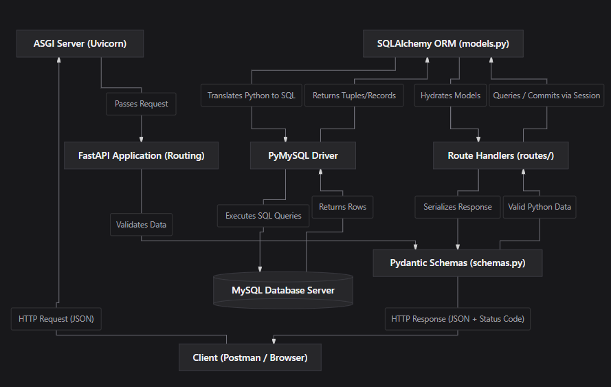
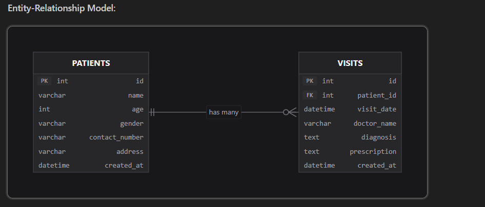

# Patient Visit History Management System 🏥

A high-performance, asynchronous RESTful API backend built with **FastAPI**, **SQLAlchemy ORM**, and **Cloud MySQL** (TiDB Serverless), developed as part of the Summer Internship program at **Silicon Institute of Technology**.

---

## 🌟 Key Features

- **Patient Management (CRUD):** Register patients, retrieve paginated patient lists, fetch full profiles nested with chronological visit histories, update records, and safely delete profiles.
- **Medical Visit Tracking (CRUD):** Log consultations with attending doctors, clinical diagnoses, and prescriptions linked directly to patient IDs.
- **Referential Integrity & Cascading:** Configured `ON DELETE CASCADE` across foreign keys to ensure all associated visit records are purged when a patient is removed, preventing orphaned data.
- **Automated Validation:** Leverages **Pydantic v2** schemas to strictly validate data types, range bounds (e.g. age between 0 and 130), and mandatory fields before database execution.
- **Database Abstraction:** Built on **SQLAlchemy 2.0** ORM, enabling zero-configuration SQLite for local development and seamless connection to Cloud MySQL in production.
- **Interactive Documentation:** Auto-generated interactive OpenAPI docs via Swagger UI (`/docs`) and ReDoc (`/redoc`).

---

## 🛠️ Technology Stack

| Layer | Technology |
| :--- | :--- |
| **Language** | Python 3.13 |
| **Web Framework** | FastAPI 0.115 |
| **ASGI Web Server** | Uvicorn 0.34 |
| **ORM & Pool** | SQLAlchemy 2.0 |
| **Database Driver** | PyMySQL + Cryptography (TLS 1.2 Encrypted) |
| **Database** | TiDB Cloud Serverless (MySQL 8.0 Compatible) / SQLite |
| **Validation** | Pydantic v2 |
| **API Testing** | Postman & Swagger UI |

---

## 🏗️ System Architecture & Request Flow

The system follows clean separation of concerns across presentation, routing, validation, ORM, and database persistence layers.



### Execution Lifecycle:
1. **Client (Postman / Browser):** Sends HTTP request with JSON payload (e.g. `POST /patients/1/visits`).
2. **ASGI Server (Uvicorn):** Asynchronously receives the request and forwards it to FastAPI.
3. **FastAPI Application (Routing):** Directs the URL to the designated route controller.
4. **Pydantic Schemas (`schemas.py`):** Validates request parameters and types before any database query runs.
5. **Route Handlers (`routes/`):** Executes business logic using the injected database session (`Depends(get_db)`).
6. **SQLAlchemy ORM (`models.py`):** Converts Python entity objects into safe, parameterized SQL queries.
7. **PyMySQL Driver:** Transmits encrypted queries over TLS to TiDB Cloud MySQL.
8. **MySQL Database Server (TiDB Cloud):** Executes queries, assigns auto-increment PKs, and commits.
9. **Hydration & Serialization:** ORM hydrates rows into models, Pydantic serializes them into JSON, and FastAPI returns HTTP `201 Created` or `200 OK`.

---

## 📊 Database Schema (Entity-Relationship Model)

The database utilizes a **1-to-Many (`1 : N`) relationship** between Patients and Visits.



### Schema & Constraints:
- **`PATIENTS` Table:**
  - `id`: INT Primary Key (Auto-Increment)
  - `name`: VARCHAR(100) NOT NULL
  - `age`: INT NOT NULL (Range: 0-130)
  - `gender`: VARCHAR(20) NOT NULL
  - `contact_number`: VARCHAR(20) NOT NULL
  - `address`: VARCHAR(255) NULLABLE
  - `created_at`: DATETIME (Server Default Now)
- **`VISITS` Table:**
  - `id`: INT Primary Key (Auto-Increment)
  - `patient_id`: INT FOREIGN KEY referencing `patients.id` (**`ON DELETE CASCADE`**)
  - `visit_date`: DATETIME NOT NULL
  - `doctor_name`: VARCHAR(100) NOT NULL
  - `diagnosis`: TEXT NOT NULL
  - `prescription`: TEXT NULLABLE
  - `created_at`: DATETIME (Server Default Now)

> **Referential Integrity:** `visits.patient_id` has `ON DELETE CASCADE`. If a patient record is deleted, all their associated consultation visits are automatically deleted, preventing orphaned records.

---

## 🚀 API Endpoints

| Method | Endpoint | Description | Status Code |
| :--- | :--- | :--- | :--- |
| `POST` | `/patients/` | Register a new patient | `201 Created` |
| `GET` | `/patients/` | Retrieve all registered patients | `200 OK` |
| `GET` | `/patients/{id}` | Get patient details with nested visit history | `200 OK` |
| `PUT` | `/patients/{id}` | Update patient information | `200 OK` |
| `DELETE`| `/patients/{id}` | Delete patient and cascade delete visits | `200 OK` |
| `POST` | `/patients/{id}/visits` | Log a medical consultation visit for a patient | `201 Created` |
| `GET` | `/patients/{id}/visits` | Retrieve all visits of a patient chronologically | `200 OK` |
| `GET` | `/visits/{visit_id}` | Retrieve individual visit details | `200 OK` |
| `PUT` | `/visits/{visit_id}` | Update clinical diagnosis or prescription | `200 OK` |
| `DELETE`| `/visits/{visit_id}` | Delete a consultation visit record | `200 OK` |

---

## 💻 Local Setup & Installation

### 1. Clone the Repository
```bash
git clone https://github.com/nagrajnag2004/patient-visit-history.git
cd patient-visit-history
```

### 2. Create and Activate Virtual Environment
```bash
# Windows PowerShell
python -m venv venv
.\venv\Scripts\activate
```

### 3. Install Dependencies
```bash
pip install -r requirements.txt
```

### 4. Configure Environment Variables
Copy `.env.example` to `.env` and configure your database:
```env
DB_TYPE=mysql
DB_HOST=gateway01.ap-northeast-1.prod.aws.tidbcloud.com
DB_PORT=4000
DB_USER=your_user
DB_PASSWORD=your_password
DB_NAME=test
```
*(Or set `DB_TYPE=sqlite` for zero-install local SQLite database).*

### 5. Start the Server
```bash
uvicorn app.main:app --reload
```

Interactive Swagger documentation will be available at:
👉 `http://127.0.0.1:8000/docs`

---

## 👨‍💻 Project Information

- **Institution:** Silicon Institute of Technology | An Autonomous Institute
- **Course:** Python Using Fast Api Internship
- **Mentor:** Shashank Shekhar
- **Author:** Animesh Soumyadarshi (CSE, 7th Semester, SIC: 23BCSC65)
